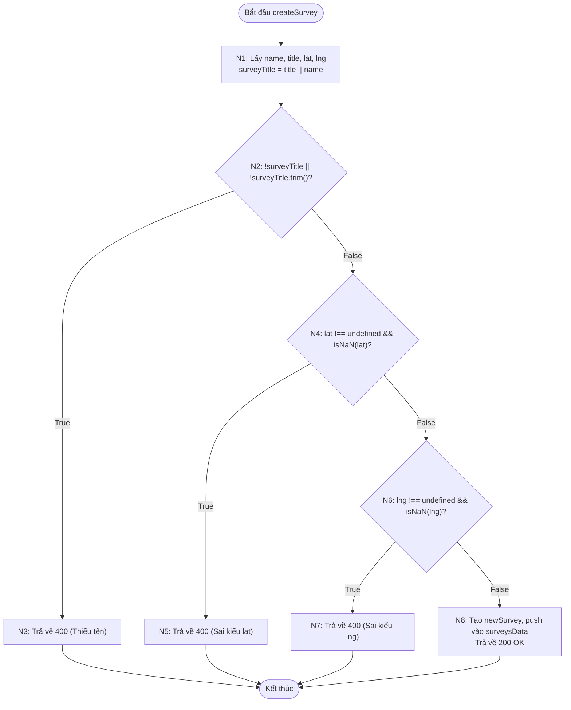
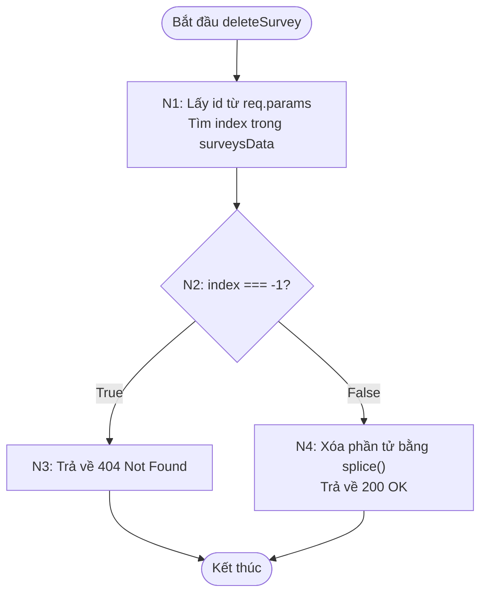

# BÁO CÁO KIỂM THỬ HỘP TRẮNG (WHITEBOX TESTING) - MODULE KHẢO SÁT (BE)
- **Mã công việc:** `[WHITEBOX][WB-SVY]`
- **Đối tượng kiểm thử:** `BE/src/controllers/surveyController.js`, `BE/src/models/surveyModel.js`, `BE/src/routes/surveyRoutes.js`
- **File kiểm thử tự động:** `tests/whitebox/survey.test.cjs`

---

## 1. Phân tích luồng điều khiển (Bảng nút – cạnh & Sơ đồ luồng)

### 1.1. Hàm `createSurvey(req, res)` (`surveyController.js`)
| Nút (Node) | Dòng code | Mô tả khối lệnh / Điều kiện | Cạnh đi ra (Edges) |
| :--- | :--- | :--- | :--- |
| **N1** | 46–47 | Lấy `name, title, lat, lng` từ `req.body`, gán `surveyTitle = title \|\| name` | $\rightarrow$ N2 |
| **N2** | 50 | Điều kiện: `if (!surveyTitle \|\| !surveyTitle.trim())` | True $\rightarrow$ N3, False $\rightarrow$ N4 |
| **N3** | 51–54 | Trả về `400 Bad Request` ("Tên khảo sát là bắt buộc") | $\rightarrow$ Kết thúc |
| **N4** | 58 | Điều kiện: `if (lat !== undefined && isNaN(Number(lat)))` | True $\rightarrow$ N5, False $\rightarrow$ N6 |
| **N5** | 59–62 | Trả về `400 Bad Request` ("Vĩ độ (lat) phải là kiểu số hợp lệ") | $\rightarrow$ Kết thúc |
| **N6** | 64 | Điều kiện: `if (lng !== undefined && isNaN(Number(lng)))` | True $\rightarrow$ N7, False $\rightarrow$ N8 |
| **N7** | 65–68 | Trả về `400 Bad Request` ("Kinh độ (lng) phải là kiểu số hợp lệ") | $\rightarrow$ Kết thúc |
| **N8** | 71–80 | Tạo object `newSurvey` (`lat = Number(lat) \|\| 0`, `lng = Number(lng) \|\| 0`), `surveysData.push(newSurvey)`, trả về `200 OK` | $\rightarrow$ Kết thúc |

- **Độ phức tạp Cyclomatic ($V(G)$):** $E - N + 2 = 10 - 8 + 2 = 4$ (tương ứng 4 đường cơ sở độc lập: `TC-WB-09`, `TC-WB-10`, `TC-WB-11`, `TC-WB-08`).



### 1.2. Hàm `deleteSurvey(req, res)` (`surveyController.js`)
| Nút (Node) | Dòng code | Mô tả khối lệnh / Điều kiện | Cạnh đi ra (Edges) |
| :--- | :--- | :--- | :--- |
| **N1** | 91–94 | Lấy `id` từ `req.params`, tìm `index = surveysData.findIndex(...)` | $\rightarrow$ N2 |
| **N2** | 97 | Điều kiện: `if (index === -1)` | True $\rightarrow$ N3, False $\rightarrow$ N4 |
| **N3** | 98–101 | Trả về `404 Not Found` (`Không tìm thấy điểm khảo sát với ID: ${id}`) | $\rightarrow$ Kết thúc |
| **N4** | 105–110 | Thực hiện `surveysData.splice(index, 1)` và trả về `200 OK` | $\rightarrow$ Kết thúc |



---

## 2. Phân tích luồng dữ liệu (Data Flow Testing)

Chọn biến **`surveys`** trong `BE/src/models/surveyModel.js`:
- **Điểm gán giá trị (Definition - Def):**
  - **Def 1 (Dòng 1):** `let surveys = [ { id: 1, ... }, { id: 2, ... } ];` — Khởi tạo mảng dữ liệu khảo sát ban đầu.
  - **Def 2 (Dòng 34):** `surveys = surveys.filter((s) => s.id != id);` — Gán lại mảng mới sau khi lọc bỏ phần tử có `id` cần xóa trong hàm `exports.delete(id)`.
- **Điểm sử dụng giá trị (Use):**
  - **Use 1 (Dòng 28 - c-use):** `exports.getAll = () => surveys;` — Trả về toàn bộ danh sách `surveys`.
  - **Use 2 (Dòng 30 - c-use):** `surveys.push(survey);` — Thêm phần tử mới vào mảng trong hàm `exports.add(survey)`.
  - **Use 3 (Dòng 34 - p-use & c-use):** `surveys.filter((s) => s.id != id)` — Duyệt và kiểm tra điều kiện `s.id != id` trên từng phần tử của `surveys`.
- **Đường đi Def–Use (DU-Path) được kiểm thử:**
  - Đường đi: `Def(1) -> Use(28) -> Use(30) -> Use(34) -> Def(34) -> Use(28)`.
  - **Test case thực thi đường đi này:** `TC-WB-DF-01` trong `tests/whitebox/survey.test.cjs` (gọi `getAll()` $\rightarrow$ gọi `add({ id: 3, ... })` $\rightarrow$ gọi `delete(1)` $\rightarrow$ gọi lại `getAll()` để xác nhận biến `surveys` cập nhật đúng).

---

## 3. Danh sách ca kiểm thử (Test Cases)

| Mã TC | Mô tả tình huống | Đầu vào (Input) | Kết quả kỳ vọng (Expected) | Kết quả thực tế (Actual) | Trạng thái |
| :--- | :--- | :--- | :--- | :--- | :--- |
| **TC-WB-01** | Lấy danh sách khi có dữ liệu | `GET /api/surveys` | Status `200`, `total: 1`, `data.length: 1` | Status `200`, `total: 1`, `data.length: 1` | PASS |
| **TC-WB-02** | Lấy danh sách khi rỗng | Xóa ID `1`, sau đó `GET /api/surveys` | Status `200`, `total: 0`, `data: []` | Status `200`, `total: 0`, `data: []` | PASS |
| **TC-WB-03** | Phân trang hợp lệ | Có 2 bản ghi, `GET /api/surveys?page=2&limit=1` | Status `200`, `page: 2`, `totalPages: 2`, `data.length: 1` | Đúng như kỳ vọng | PASS |
| **TC-WB-04** | Phân trang không hợp lệ (chữ) | `GET /api/surveys?page=abc&limit=xyz` | Status `200`, fallback về `page: 1`, `limit: 10` | Đúng như kỳ vọng | PASS |
| **TC-WB-05** | Phân trang không hợp lệ (số âm) | `GET /api/surveys?page=-1&limit=5` | Status `200` (hiện tại), `page: -1`, `data: []` | Đúng hành vi hiện tại | PASS |
| **TC-WB-06** | Lấy chi tiết ID tồn tại | `GET /api/surveys/1` | Status `200`, `data.id: 1` | Status `200`, `data.id: 1` | PASS |
| **TC-WB-07** | Lấy chi tiết ID không tồn tại | `GET /api/surveys/99999` | Status `404`, `status: "error"` | Status `404`, `status: "error"` | PASS |
| **TC-WB-08** | Tạo khảo sát hợp lệ | `POST /api/surveys` + Token + `{title, lat, lng}` | Status `200`, `status: "success"`, trả về `data` | Đúng như kỳ vọng | PASS |
| **TC-WB-09** | Tạo khảo sát thiếu tên | `POST /api/surveys` + Token + `{title: " "}` | Status `400`, `"Tên khảo sát là bắt buộc"` | Đúng như kỳ vọng | PASS |
| **TC-WB-10** | Tạo khảo sát sai kiểu `lat` | `POST /api/surveys` + Token + `{title, lat: "abc"}` | Status `400`, `"Vĩ độ (lat) phải là kiểu số hợp lệ"` | Đúng như kỳ vọng | PASS |
| **TC-WB-11** | Tạo khảo sát sai kiểu `lng` | `POST /api/surveys` + Token + `{title, lng: "xyz"}` | Status `400`, `"Kinh độ (lng) phải là kiểu số hợp lệ"` | Đúng như kỳ vọng | PASS |
| **TC-WB-12** | Tạo khảo sát thiếu Token | `POST /api/surveys` (không header Authorization) | Status `401`, có trường `error` | Đúng như kỳ vọng | PASS |
| **TC-WB-15** | Tạo khảo sát dùng `name`, trống tọa độ | `POST /api/surveys` + Token + `{name}` | Status `200`, `title` lấy từ `name`, `lat: 0`, `lng: 0` | Đúng như kỳ vọng | PASS |
| **TC-WB-13** | Xóa khảo sát ID tồn tại | `DELETE /api/surveys/1` + Token | Status `200`, `"Đã xóa thành công"` | Đúng như kỳ vọng | PASS |
| **TC-WB-14** | Xóa khảo sát ID không tồn tại | `DELETE /api/surveys/99999` + Token | Status `404` (`status: "error"`) | Bản cũ trả `200` (FAIL); bản đã vá `BUG-BE-02` trả `404` | PASS (sau vá) |
| **TC-WB-DF-01** | Luồng dữ liệu biến `surveys` | `getAll()` $\rightarrow$ `add(id:3)` $\rightarrow$ `delete(1)` $\rightarrow$ `getAll()` | Mảng `surveys` cập nhật đúng qua các bước | Đúng như kỳ vọng | PASS |

---

## 4. Ghi nhận lỗi & Đề xuất cải tiến (Bug / Findings)
1. **Hành vi xóa ID không tồn tại (`BUG-BE-02`):**
   - Trong phiên bản trước khi vá lỗi, `DELETE /api/surveys/99999` trả về HTTP `200` dù ID không tồn tại. Trong mã nguồn hiện tại của `surveyController.js`, lỗi này đã được xử lý trả về HTTP `404`.
   - Ở tầng Model (`surveyModel.js`, hàm `exports.delete`), hàm hiện chỉ thực hiện `surveys = surveys.filter(...)` mà chưa trả về giá trị boolean (`true/false`) để thông báo có bản ghi nào bị xóa hay không.
2. **Tách rời Controller và Model (`surveyController.js` vs `surveyModel.js`):**
   - `surveyController.js` đang dùng mảng cục bộ `surveysData` thay vì gọi qua các hàm của `surveyModel.js`. Đề xuất hợp nhất nguồn dữ liệu về `surveyModel.js`.
3. **Validate tham số phân trang âm:**
   - Khi truyền `page=-1` hoặc `limit=-5`, biểu thức `parseInt("-1") || 1` vẫn nhận giá trị âm thay vì chuẩn hóa về số dương (`Math.max(1, parseInt(...) || 1)`) hoặc trả về lỗi `400 Bad Request`.

---

## 5. Log thực thi & Độ bao phủ mã nguồn (Coverage)

```text
PASS tests/whitebox/survey.test.cjs
  [WHITEBOX][WB-SVY] Kiểm thử Controller & Model Khảo sát BE
    1. Lấy danh sách khảo sát (GET /api/surveys)
      √ TC-WB-01: Lấy danh sách khi có dữ liệu mặc định (156 ms)
      √ TC-WB-02: Lấy danh sách khi dữ liệu rỗng (86 ms)
      √ TC-WB-03: Phân trang với tham số hợp lệ (page=2, limit=1) (94 ms)
      √ TC-WB-04: Phân trang với tham số không hợp lệ (page/limit là chữ cái -> fallback mặc định) (85 ms)
      √ TC-WB-05: Phân trang với tham số không hợp lệ (page âm: page=-1&limit=5) (78 ms)
    2. Lấy chi tiết khảo sát theo ID (GET /api/surveys/:id)
      √ TC-WB-06: Lấy chi tiết khảo sát với ID tồn tại (77 ms)
      √ TC-WB-07: Lấy chi tiết khảo sát với ID không tồn tại -> trả 404 (80 ms)
    3. Tạo mới khảo sát (POST /api/surveys)
      √ TC-WB-08: Tạo khảo sát thành công với dữ liệu hợp lệ và token (90 ms)
      √ TC-WB-09: Tạo khảo sát thất bại khi thiếu tên khảo sát -> 400 (76 ms)
      √ TC-WB-10: Tạo khảo sát thất bại khi vĩ độ (lat) không phải số -> 400 (81 ms)
      √ TC-WB-11: Tạo khảo sát thất bại khi kinh độ (lng) không phải số -> 400 (75 ms)
      √ TC-WB-12: Từ chối tạo khảo sát khi không gửi Token -> 401 (81 ms)
      √ TC-WB-15: Tạo khảo sát dùng trường `name` và bỏ trống tọa độ lat/lng (70 ms)
    4. Xóa khảo sát (DELETE /api/surveys/:id)
      √ TC-WB-13: Xóa khảo sát với ID tồn tại -> 200 (71 ms)
      √ TC-WB-14: Xóa khảo sát với ID không tồn tại (99999) -> kỳ vọng 404 Not Found (73 ms)
    5. Kiểm thử luồng dữ liệu (Def-Use) trên surveyModel.js
      √ TC-WB-DF-01: Đường đi Def(dòng 1) -> Use(dòng 30) -> Def(dòng 34) -> Use(dòng 28) của biến `surveys` (78 ms)

---------------------|---------|----------|---------|---------|-------------------
File                 | % Stmts | % Branch | % Funcs | % Lines | Uncovered Line #s
---------------------|---------|----------|---------|---------|-------------------
All files            |     100 |      100 |     100 |     100 |
 controllers         |     100 |      100 |     100 |     100 |
  surveyController.js|     100 |      100 |     100 |     100 |
 models              |     100 |      100 |     100 |     100 |
  surveyModel.js     |     100 |      100 |     100 |     100 |
 routes              |     100 |      100 |     100 |     100 |
  surveyRoutes.js    |     100 |      100 |     100 |     100 |
---------------------|---------|----------|---------|---------|-------------------
Test Suites: 1 passed, 1 total
Tests:       16 passed, 16 total
Snapshots:   0 total
Time:        2.116 s, estimated 8 s
Ran all test suites matching tests/whitebox/survey.test.cjs.
```